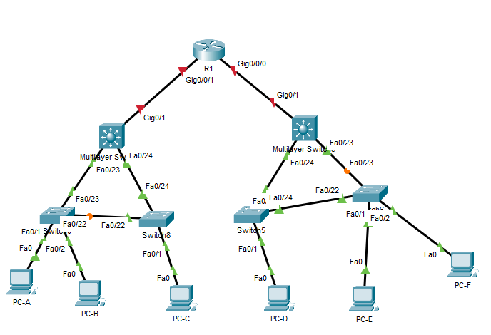
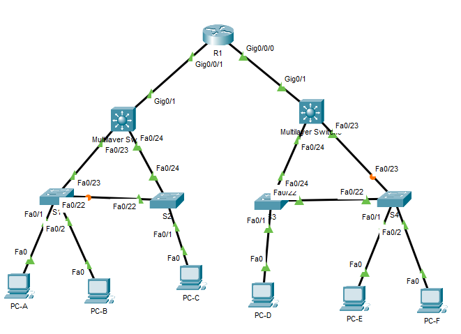
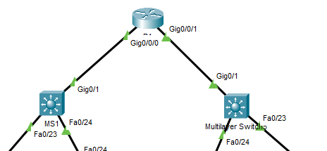
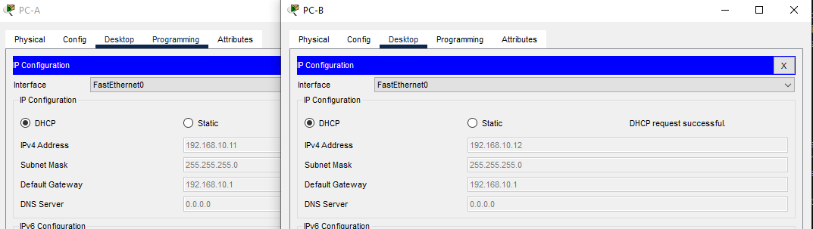
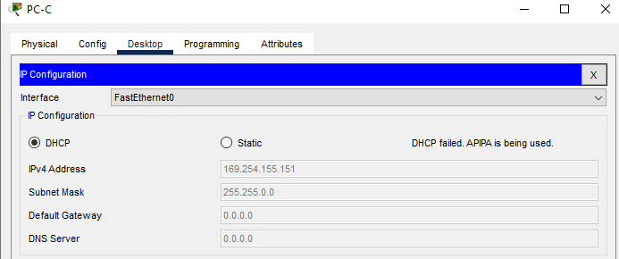
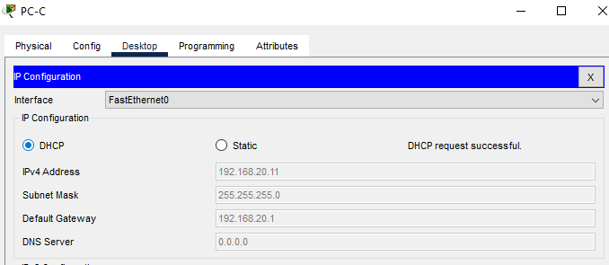
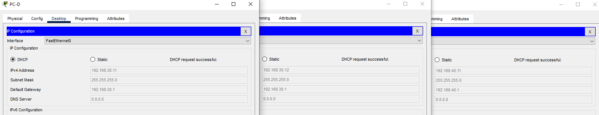

# Proekt_Построение сети с нуля между зданиями Пулковской обсерватории

Работа выполнена на ПК с установленным Cisco Packet Tracer.

#### Топология



#### Таблица адресации

 Устройство| Интерфейс | IP-адрес     | Маска подсети| шлюз по ум
:--------:|:---------:|:------------:| :-----------:| :--------:
 R1       | G0/0/0    | 192.168.0.1  | 255.255.255.252 | 
 R1       | G0/0/1     | 192.168.0.5  | 255.255.255.252 |
 R1       |Loopback 1  | 203.0.113.1  | 255.255.255.248 | 
 MS1      |  G0/1      | 192.168.0.2   | 255.255.255.252 | 
 MS1      | SVI VLAN 10 | 192.168.10.1  | 255.255.255.0 |
 MS1      | SVI VLAN 20 | 192.168.20.1  | 255.255.255.0 | 
 MS1      | SVI VLAN 99 | 192.168.99.2  | 255.255.255.224 | 192.168.99.1
 MS2      |   G0/1      | 192.168.0.6  | 255.255.255.252 | 
 MS2      | SVI VLAN 30 | 192.168.30.1   | 255.255.255.0 | 
 MS2      | SVI VLAN 40 | 192.168.40.1  | 255.255.255.224 | 
 MS2      | SVI VLAN 99 | 192.168.99.3  | 255.255.255.224 | 192.168.99.1
 S1       | SVI VLAN 99 | 192.168.99.11	 | 255.255.255.224 | 192.168.99.1
 S2       | SVI VLAN 99 | 192.168.99.12  | 255.255.255.224 | 192.168.99.1
 S3       | SVI VLAN 99 | 192.168.99.13  | 255.255.255.224 | 192.168.99.1
 S4       | SVI VLAN 99 | 192.168.99.14 | 255.255.255.224 | 192.168.99.1
 PC-A      | NIC        | DHCP          | 255.255.255.0 |  192.168.10.1
 PC-B      | NIC        | DHCP          | 255.255.255.0 |  192.168.10.1
 PC-C      | NIC        | DHCP         | 255.255.255.0 |  192.168.20.1
 PC-D      | NIC        | DHCP         | 255.255.255.0 |  192.168.30.1
 PC-E      | NIC        | DHCP         | 255.255.255.0 |  192.168.30.1
 PC-F      | NIC        | DHCP         | 255.255.255.0 |  192.168.40.1


#### Шаг 1. Настройка маршрутизатора

```
Router>en
Router#conf t
Enter configuration commands, one per line.  End with CNTL/Z.
Router(config)#ho
Router(config)#hostname R1
R1(config)#no ip domain-lo
R1(config)#no ip domain-lookup 
R1(config)#ena
R1(config)#enable se
R1(config)#enable secret class
R1(config)#lin
R1(config)#line co
R1(config)#line console 0
R1(config-line)#pas
R1(config-line)#password cisco
R1(config-line)#exit
R1(config)#lin
R1(config)#line vt
R1(config)#line vty 0 4
R1(config-line)#pas
R1(config-line)#password cisco
R1(config-line)#login
R1(config-line)#exit
R1(config)#line console 0
R1(config-line)#pas
R1(config-line)#password cisco
R1(config-line)#login
R1(config-line)#exit
R1(config)#ser
R1(config)#service pa
R1(config)#service password-encryption 
R1(config)#ban
R1(config)#banner m
R1(config)#banner motd #LAST SO YOU CANT GO#
R1(config)#int ;o
R1(config)#int lo
R1(config)#int loopback 1

R1(config-if)#
%LINK-5-CHANGED: Interface Loopback1, changed state to up

%LINEPROTO-5-UPDOWN: Line protocol on Interface Loopback1, changed state to up
des
R1(config-if)#description LOOPBACK_1
R1(config-if)#ip ad
R1(config-if)#ip address 203.0.113.1 255.255.255.248
R1(config-if)#exit
R1(config)#int g0/0/0
R1(config-if)#des
R1(config-if)#description TO_MS1
R1(config-if)#ip ad
R1(config-if)#ip address 192.168.0.1 255.255.255.252
R1(config-if)#no sh
R1(config-if)#no shutdown 

R1(config-if)#
%LINK-5-CHANGED: Interface GigabitEthernet0/0/0, changed state to up

%LINEPROTO-5-UPDOWN: Line protocol on Interface GigabitEthernet0/0/0, changed state to up
exit
R1(config)#int g0/0/1
R1(config-if)#de
R1(config-if)#des
R1(config-if)#description TO_MS2
R1(config-if)#ip ad
R1(config-if)#ip address 192.168.0.5 255.255.255.252
R1(config-if)#no sh
R1(config-if)#no shutdown 

R1(config-if)#
%LINK-5-CHANGED: Interface GigabitEthernet0/0/1, changed state to up

%LINEPROTO-5-UPDOWN: Line protocol on Interface GigabitEthernet0/0/1, changed state to up
exit
R1(config)#end
R1#
%SYS-5-CONFIG_I: Configured from console by console
cop
R1#copy r
R1#copy running-config st
R1#copy running-config startup-config 
Destination filename [startup-config]? 
Building configuration...
[OK]
R1#
```



#### Шаг 2. Настройка L3 коммутаторов

базовая настройка улетела вверх, поэтому продублирую при настройке второго коммутатора.

```
MS1(config)#banner motd #AAA IS WORKING PLZ CLICK ESC#
MS1(config)#ip rou
MS1(config)#ip rout
MS1(config)#ip routi
MS1(config)#ip routing 
MS1(config)#vlan 10
MS1(config-vlan)#name VIP_USER
MS1(config-vlan)#EXIT
MS1(config)#vlan 20
MS1(config-vlan)#name USER
MS1(config-vlan)#EXIT
MS1(config)#VLAN 99
MS1(config-vlan)#name MANAGEMENT
MS1(config-vlan)#EXIT
MS1(config)#VLAN 999
MS1(config-vlan)#NAME PARKING
MS1(config-vlan)#EXIT
MS1(config)#VLAN 1000 NATIVE
                      ^
% Invalid input detected at '^' marker.
	
MS1(config)#VLAN 1000 
MS1(config-vlan)#NA
MS1(config-vlan)#NAme NATIVE
MS1(config-vlan)#EXIT
MS1(config)#int go/1
                 ^
% Invalid input detected at '^' marker.
	
MS1(config)#int g0/1
MS1(config-if)#des
MS1(config-if)#description TO_R1
MS1(config-if)#no sw
MS1(config-if)#no switchport 
MS1(config-if)#
%LINEPROTO-5-UPDOWN: Line protocol on Interface GigabitEthernet0/1, changed state to down

%LINEPROTO-5-UPDOWN: Line protocol on Interface GigabitEthernet0/1, changed state to up
ip adr
MS1(config-if)#ip adre
MS1(config-if)#ip add
MS1(config-if)#ip address 192.168.0.2 255.255.255.252
MS1(config-if)#no sh
MS1(config-if)#no shutdown 
MS1(config-if)#exit
MS1(config)#int vlan 10
MS1(config-if)#
%LINK-5-CHANGED: Interface Vlan10, changed state to up
des
MS1(config-if)#description VLAN_10
MS1(config-if)#ip add
MS1(config-if)#ip address 192.168.10.1 255.255.255.0
MS1(config-if)#no sh
MS1(config-if)#no shutdown 
MS1(config-if)#exit
MS1(config)#int vlan 20
MS1(config-if)#
%LINK-5-CHANGED: Interface Vlan20, changed state to up
description VLAN_20
MS1(config-if)#ip address 192.168.20.1 255.255.255.0
MS1(config-if)#no sh
MS1(config-if)#no shutdown 
MS1(config-if)#exit
MS1(config)#int vlan 99
MS1(config-if)#
%LINK-5-CHANGED: Interface Vlan99, changed state to up
des
MS1(config-if)#description MANAGEMENT
MS1(config-if)#ip address 192.168.99.2 255.255.255.224
MS1(config-if)#NO SH
MS1(config-if)#NO SHutdown 
MS1(config-if)#EXIT
MS1(config)#INT VLAN 999
MS1(config-if)#
%LINK-5-CHANGED: Interface Vlan999, changed state to up
DE
MS1(config-if)#DES
MS1(config-if)#EXIT
MS1(config)#int ra
MS1(config)#int range f0/23-24
MS1(config-if-range)#des
MS1(config-if-range)#description TRUNK_S1S2
MS1(config-if-range)#sw
MS1(config-if-range)#switchport tr
MS1(config-if-range)#switchport trunk en
MS1(config-if-range)#switchport trunk encapsulation d
MS1(config-if-range)#switchport trunk encapsulation dot1q 
MS1(config-if-range)#sw
MS1(config-if-range)#switchport m
MS1(config-if-range)#switchport mode t
MS1(config-if-range)#switchport mode trunk 


MS1(config-if-range)#
%LINEPROTO-5-UPDOWN: Line protocol on Interface FastEthernet0/23, changed state to down

%LINEPROTO-5-UPDOWN: Line protocol on Interface FastEthernet0/23, changed state to up

%LINEPROTO-5-UPDOWN: Line protocol on Interface Vlan10, changed state to up

%LINEPROTO-5-UPDOWN: Line protocol on Interface Vlan20, changed state to up

%LINEPROTO-5-UPDOWN: Line protocol on Interface Vlan99, changed state to up

%LINEPROTO-5-UPDOWN: Line protocol on Interface Vlan999, changed state to up

%LINEPROTO-5-UPDOWN: Line protocol on Interface FastEthernet0/24, changed state to down

%LINEPROTO-5-UPDOWN: Line protocol on Interface FastEthernet0/24, changed state to up
sw
MS1(config-if-range)#switchport tr
MS1(config-if-range)#switchport trunk n
MS1(config-if-range)#switchport trunk native v
MS1(config-if-range)#switchport trunk native vlan 1000
MS1(config-if-range)#sw
MS1(config-if-range)#switchport tr
MS1(config-if-range)#switchport trunk al
MS1(config-if-range)#switchport trunk allowed v
MS1(config-if-range)#switchport trunk allowed vlan 10,20,99,1000
%CDP-4-NATIVE_VLAN_MISMATCH: Native VLAN mismatch discovered on FastEthernet0/23 (1000), with Switch FastEthernet0/23 (1).

%CDP-4-NATIVE_VLAN_MISMATCH: Native VLAN mismatch discovered on FastEthernet0/24 (1000), with Switch FastEthernet0/24 (1).
%SPANTREE-2-RECV_PVID_ERR: Received BPDU with inconsistent peer vlan id 1 on FastEthernet0/24 VLAN1000.

%SPANTREE-2-BLOCK_PVID_LOCAL: Blocking FastEthernet0/24 on VLAN1000. Inconsistent local vlan.


MS1(config-if-range)#switchport trunk allowed vlan 10,20,99,1000
MS1(config-if-range)#no sh
MS1(config-if-range)#no shutdown 
MS1(config-if-range)#exit
MS1(config)#int ra
MS1(config)#int range f0/1-22, g0/2
MS1(config-if-range)#sw
MS1(config-if-range)#switchport m
MS1(config-if-range)#switchport mode a
MS1(config-if-range)#switchport mode access 
MS1(config-if-range)#sw
MS1(config-if-range)#switchport a
MS1(config-if-range)#switchport access vlan 999
MS1(config-if-range)#shu
MS1(config-if-range)#shutdown 

%LINK-5-CHANGED: Interface FastEthernet0/1, changed state to administratively down

%LINK-5-CHANGED: Interface FastEthernet0/2, changed state to administratively down

%LINK-5-CHANGED: Interface FastEthernet0/3, changed state to administratively down

%LINK-5-CHANGED: Interface FastEthernet0/4, changed state to administratively down

%LINK-5-CHANGED: Interface FastEthernet0/5, changed state to administratively down

%LINK-5-CHANGED: Interface FastEthernet0/6, changed state to administratively down

%LINK-5-CHANGED: Interface FastEthernet0/7, changed state to administratively down

%LINK-5-CHANGED: Interface FastEthernet0/8, changed state to administratively down

%LINK-5-CHANGED: Interface FastEthernet0/9, changed state to administratively down

%LINK-5-CHANGED: Interface FastEthernet0/10, changed state to administratively down

%LINK-5-CHANGED: Interface FastEthernet0/11, changed state to administratively down

%LINK-5-CHANGED: Interface FastEthernet0/12, changed state to administratively down

%LINK-5-CHANGED: Interface FastEthernet0/13, changed state to administratively down

%LINK-5-CHANGED: Interface FastEthernet0/14, changed state to administratively down

%LINK-5-CHANGED: Interface FastEthernet0/15, changed state to administratively down

%LINK-5-CHANGED: Interface FastEthernet0/16, changed state to administratively down

%LINK-5-CHANGED: Interface FastEthernet0/17, changed state to administratively down

%LINK-5-CHANGED: Interface FastEthernet0/18, changed state to administratively down

%LINK-5-CHANGED: Interface FastEthernet0/19, changed state to administratively down

%LINK-5-CHANGED: Interface FastEthernet0/20, changed state to administratively down

%LINK-5-CHANGED: Interface FastEthernet0/21, changed state to administratively down

%LINK-5-CHANGED: Interface FastEthernet0/22, changed state to administratively down

%LINK-5-CHANGED: Interface GigabitEthernet0/2, changed state to administratively down
MS1(config-if-range)#exit
MS1(config)#end
MS1#
%SYS-5-CONFIG_I: Configured from console by console
cop
MS1#copy 
%CDP-4-NATIVE_VLAN_MISMATCH: Native VLAN mismatch discovered on FastEthernet0/24 (1000), with Switch FastEthernet0/24 (1).

%CDP-4-NATIVE_VLAN_MISMATCH: Native VLAN mismatch discovered on FastEthernet0/23 (1000), with Switch FastEthernet0/23 (1).
MS1(config)#ip route 0.0.0.0 0.0.0.0 192.168.0.1
r
MS1#copy running-config st
MS1#copy running-config startup-config 
Destination filename [startup-config]? 
Building configuration...
[OK]
MS1#
```

```
Switch>en
Switch#conf t
Enter configuration commands, one per line.  End with CNTL/Z.
Switch(config)#ho
Switch(config)#hostname MS2
MS2(config)#ena
MS2(config)#enable se
MS2(config)#no ip domain-lo
MS2(config)#no ip domain-lookup 
MS2(config)#ena
MS2(config)#enable se
MS2(config)#enable secret class
MS2(config)#enable secret class
MS2(config)#lin
MS2(config)#line co
MS2(config)#line console 0
MS2(config-line)#pas
MS2(config-line)#password cisco
MS2(config-line)#login
MS2(config-line)#exit
MS2(config)#;ine vt
MS2(config)#line vt0 4
MS2(config)#line v
MS2(config)#line vty 0 4
MS2(config-line)#pas
MS2(config-line)#password cisco
MS2(config-line)#login
MS2(config-line)#exit
MS2(config)#se
MS2(config)#service pas
MS2(config)#service password-encryption 
MS2(config)#ba
MS2(config)#banner m
MS2(config)#banner motd #WHO READ WHO MOLODEC#
MS2(config)#ip rou
MS2(config)#ip rout
MS2(config)#ip rout
% Ambiguous command: "ip rout"
MS2(config)#ip routi
MS2(config)#ip routing 
MS2(config)#vlan 30
MS2(config-vlan)#name VIP_USER_2
MS2(config-vlan)#exit
MS2(config)#vlan 40
MS2(config-vlan)#na
MS2(config-vlan)#name USER_2
MS2(config-vlan)#EXIT
MS2(config)#VLAN 99
MS2(config-vlan)#NAME MANAGEMENT
MS2(config-vlan)#EXIT
MS2(config)#VLAN 999
MS2(config-vlan)#PARKING
                 ^
% Invalid input detected at '^' marker.
	
MS2(config-vlan)#NAME PARKING
MS2(config-vlan)#EXIT
MS2(config)#VLAN 1000
MS2(config-vlan)#N
MS2(config-vlan)#NA
MS2(config-vlan)#NAme NATIVE
MS2(config-vlan)#EXIT
MS2(config)#int g0/1
MS2(config-if)#des
MS2(config-if)#description TO_R1
MS2(config-if)#no sw
MS2(config-if)#no switchport 
MS2(config-if)#
%LINEPROTO-5-UPDOWN: Line protocol on Interface GigabitEthernet0/1, changed state to down

%LINEPROTO-5-UPDOWN: Line protocol on Interface GigabitEthernet0/1, changed state to up
ip add
MS2(config-if)#ip address 192.168.0.6 255.255.255.252
MS2(config-if)#no sh
MS2(config-if)#no shutdown 
MS2(config-if)#exit
MS2(config)#int vl
MS2(config)#int vlan 30
MS2(config-if)#
%LINK-5-CHANGED: Interface Vlan30, changed state to up
des
MS2(config-if)#description TO_VLAN_30
MS2(config-if)#ip ad
MS2(config-if)#ip address 192.168.30.1 255.255.255.0
MS2(config-if)#no sh
MS2(config-if)#no shutdown 
MS2(config-if)#exit
MS2(config)#int vlan 40
MS2(config-if)#
%LINK-5-CHANGED: Interface Vlan40, changed state to up
des
MS2(config-if)#description 
MS2(config-if)#description TO_VLAN_40
MS2(config-if)#ip add
MS2(config-if)#ip address 192.168.40.1 255.255.255.0
MS2(config-if)#no sh
MS2(config-if)#no shutdown 
MS2(config-if)#exit

MS2(config)#int vlan 99
MS2(config-if)#
%LINK-5-CHANGED: Interface Vlan99, changed state to up
des
MS2(config-if)#description MANAGEMENT
MS2(config-if)#ip add
MS2(config-if)#ip address 192.168.99.3 255.255.255.224
MS2(config-if)#no sh
MS2(config-if)#no shutdown 
MS2(config-if)#exit
MS2(config)#int ra f0/23-24
MS2(config-if-range)#des
MS2(config-if-range)#description tr
MS2(config-if-range)#description tru
MS2(config-if-range)#description TRUNK_S3S4
MS2(config-if-range)#sw
MS2(config-if-range)#switchport m
MS2(config-if-range)#switchport mode tr
MS2(config-if-range)#switchport mode trunk 
Command rejected: An interface whose trunk encapsulation is "Auto" can not be configured to "trunk" mode.
Command rejected: An interface whose trunk encapsulation is "Auto" can not be configured to "trunk" mode.
MS2(config-if-range)#sw
MS2(config-if-range)#switchport tr
MS2(config-if-range)#switchport trunk na
MS2(config-if-range)#switchport trunk native v
MS2(config-if-range)#switchport trunk native vlan 1000
MS2(config-if-range)#sw
MS2(config-if-range)#switchport tr
MS2(config-if-range)#switchport trunk all
MS2(config-if-range)#switchport trunk allowed vl
MS2(config-if-range)#switchport trunk allowed vlan 30,40,99,1000
MS2(config-if-range)#no sh
MS2(config-if-range)#no shutdown 
MS2(config-if-range)#exit
MS2(config)#
MS2(config)#int ra f0/1-22, g0/2
MS2(config-if-range)#sw
MS2(config-if-range)#switchport m
MS2(config-if-range)#switchport mode a
MS2(config-if-range)#switchport mode access 
MS2(config-if-range)#sw
MS2(config-if-range)#switchport a
MS2(config-if-range)#switchport access vl
MS2(config-if-range)#switchport access vlan 999
MS2(config-if-range)#sh
MS2(config-if-range)#shutdown 

%LINK-5-CHANGED: Interface FastEthernet0/1, changed state to administratively down

%LINK-5-CHANGED: Interface FastEthernet0/2, changed state to administratively down

%LINK-5-CHANGED: Interface FastEthernet0/3, changed state to administratively down

%LINK-5-CHANGED: Interface FastEthernet0/4, changed state to administratively down

%LINK-5-CHANGED: Interface FastEthernet0/5, changed state to administratively down

%LINK-5-CHANGED: Interface FastEthernet0/6, changed state to administratively down

%LINK-5-CHANGED: Interface FastEthernet0/7, changed state to administratively down

%LINK-5-CHANGED: Interface FastEthernet0/8, changed state to administratively down

%LINK-5-CHANGED: Interface FastEthernet0/9, changed state to administratively down

%LINK-5-CHANGED: Interface FastEthernet0/10, changed state to administratively down

%LINK-5-CHANGED: Interface FastEthernet0/11, changed state to administratively down

%LINK-5-CHANGED: Interface FastEthernet0/12, changed state to administratively down

%LINK-5-CHANGED: Interface FastEthernet0/13, changed state to administratively down

%LINK-5-CHANGED: Interface FastEthernet0/14, changed state to administratively down

%LINK-5-CHANGED: Interface FastEthernet0/15, changed state to administratively down

%LINK-5-CHANGED: Interface FastEthernet0/16, changed state to administratively down

%LINK-5-CHANGED: Interface FastEthernet0/17, changed state to administratively down

%LINK-5-CHANGED: Interface FastEthernet0/18, changed state to administratively down

%LINK-5-CHANGED: Interface FastEthernet0/19, changed state to administratively down

%LINK-5-CHANGED: Interface FastEthernet0/20, changed state to administratively down

%LINK-5-CHANGED: Interface FastEthernet0/21, changed state to administratively down

%LINK-5-CHANGED: Interface FastEthernet0/22, changed state to administratively down

%LINK-5-CHANGED: Interface GigabitEthernet0/2, changed state to administratively down
MS2(config-if-range)#exit
MS2(config)#xo
MS2(config)#xo
            ^
% Invalid input detected at '^' marker.
MS2(config)#ip route 0.0.0.0 0.0.0.0 192.168.0.5
MS2(config)#end
MS2#
%SYS-5-CONFIG_I: Configured from console by console
cop
MS2#copy r
MS2#copy running-config st
MS2#copy running-config startup-config 
Destination filename [startup-config]? 
Building configuration...
[OK]
MS2#
```

```
MS2#show interfaces tr
MS2#show interfaces trunk 
```

У меня не поднялся транк на втором коммутаторе, смотрю в чём дело.
Забыла строчку инкапсуляции и не заметил, что транк не образовался, исправляю.

```
MS2(config)#int ra f0/23-2
MS2(config-if-range)#sw
MS2(config-if-range)#switchport tr
MS2(config-if-range)#switchport trunk e
MS2(config-if-range)#switchport trunk encapsulation d
MS2(config-if-range)#switchport trunk encapsulation dot1q 
MS2(config-if-range)#sw
MS2(config-if-range)#switchport m
MS2(config-if-range)#switchport mode tr
MS2(config-if-range)#switchport mode trunk 

MS2(config-if-range)#
%LINEPROTO-5-UPDOWN: Line protocol on Interface FastEthernet0/23, changed state to down

%LINEPROTO-5-UPDOWN: Line protocol on Interface FastEthernet0/23, changed state to up

%LINEPROTO-5-UPDOWN: Line protocol on Interface Vlan30, changed state to up

%LINEPROTO-5-UPDOWN: Line protocol on Interface Vlan40, changed state to up

%LINEPROTO-5-UPDOWN: Line protocol on Interface Vlan99, changed state to up
```

```
MS2#show ip interface br
MS2#show ip interface brief 
Interface              IP-Address      OK? Method Status                Protocol 
FastEthernet0/1        unassigned      YES unset  administratively down down 
FastEthernet0/2        unassigned      YES unset  administratively down down 
FastEthernet0/3        unassigned      YES unset  administratively down down 
FastEthernet0/4        unassigned      YES unset  administratively down down 
FastEthernet0/5        unassigned      YES unset  administratively down down 
FastEthernet0/6        unassigned      YES unset  administratively down down 
FastEthernet0/7        unassigned      YES unset  administratively down down 
FastEthernet0/8        unassigned      YES unset  administratively down down 
FastEthernet0/9        unassigned      YES unset  administratively down down 
FastEthernet0/10       unassigned      YES unset  administratively down down 
FastEthernet0/11       unassigned      YES unset  administratively down down 
FastEthernet0/12       unassigned      YES unset  administratively down down 
FastEthernet0/13       unassigned      YES unset  administratively down down 
FastEthernet0/14       unassigned      YES unset  administratively down down 
FastEthernet0/15       unassigned      YES unset  administratively down down 
FastEthernet0/16       unassigned      YES unset  administratively down down 
FastEthernet0/17       unassigned      YES unset  administratively down down 
FastEthernet0/18       unassigned      YES unset  administratively down down 
FastEthernet0/19       unassigned      YES unset  administratively down down 
FastEthernet0/20       unassigned      YES unset  administratively down down 
FastEthernet0/21       unassigned      YES unset  administratively down down 
FastEthernet0/22       unassigned      YES unset  administratively down down 
FastEthernet0/23       unassigned      YES unset  up                    up 
FastEthernet0/24       unassigned      YES unset  up                    up 
GigabitEthernet0/1     192.168.0.6     YES manual up                    up 
GigabitEthernet0/2     unassigned      YES unset  administratively down down 
Vlan1                  unassigned      YES unset  administratively down down 
Vlan30                 192.168.30.1    YES manual up                    up 
Vlan40                 192.168.40.1    YES manual up                    up 
Vlan99                 192.168.99.3    YES manual up                    up
```

```
R1#ping 192.168.0.2

Type escape sequence to abort.
Sending 5, 100-byte ICMP Echos to 192.168.0.2, timeout is 2 seconds:
.....
Success rate is 0 percent (0/5)

R1#ping 192.168.0.6

Type escape sequence to abort.
Sending 5, 100-byte ICMP Echos to 192.168.0.6, timeout is 2 seconds:
.....
Success rate is 0 percent (0/5)
```

Очень долго не могла понять почему нет пинга между с R1 на MS1 и MS2... в итоге оказалось я перепутала физическое подключение интерфейсов и оба маршрутизатора были между собой перепутаны. Переставила кабели. Все заработало.



```
R1#ping 192.168.0.6

Type escape sequence to abort.
Sending 5, 100-byte ICMP Echos to 192.168.0.6, timeout is 2 seconds:
!!!!!
Success rate is 100 percent (5/5), round-trip min/avg/max = 0/0/0 ms

R1#ping 192.168.0.2

Type escape sequence to abort.
Sending 5, 100-byte ICMP Echos to 192.168.0.2, timeout is 2 seconds:
!!!!!
Success rate is 100 percent (5/5), round-trip min/avg/max = 0/0/0 ms
```

#### Шаг 3. Настройка коммутаторов S1 и S2

```
Switch>en
Switch#conf t
Enter configuration commands, one per line.  End with CNTL/Z.
Switch(config)#h
Switch(config)#hostname 
%CDP-4-NATIVE_VLAN_MISMATCH: Native VLAN mismatch discovered on FastEthernet0/23 (1), with MS1 FastEthernet0/23 (1000).
S1
S1(config)#NO IP DOMAIN-l
S1(config)#NO IP DOMAIN-lookup 
S1(config)#ena
S1(config)#enable s
S1(config)#enable secret class
S1(config)#enable secret class
S1(config)#lin
S1(config)#line  c
S1(config)#line  console 0
S1(config-line)#pas
S1(config-line)#password cisco
S1(config-line)#login
S1(config-line)#exit
S1(config)#lin
S1(config)#line vt
S1(config)#line vty 0 4
S1(config)#line vty 0 4
S1(config-line)#pas
S1(config-line)#password cisco
S1(config-line)#login
S1(config-line)#exit
S1(config)#se
S1(config)#service pas
S1(config)#service password-encryption 
S1(config)#service password-encryption 
S1(config)#
%CDP-4-NATIVE_VLAN_MISMATCH: Native VLAN mismatch discovered on FastEthernet0/23 (1), with MS1 FastEthernet0/23 (1000).
ban
S1(config)#banner m
S1(config)#banner motd #WHY YOU STILL HERE#?
LINE  
S1(config)#banner motd #WHY YOU STILL HERE#
S1(config)#vlan 10
S1(config-vlan)#na
S1(config-vlan)#name VIP_USER
S1(config-vlan)#
%CDP-4-NATIVE_VLAN_MISMATCH: Native VLAN mismatch discovered on FastEthernet0/23 (1), with MS1 FastEthernet0/23 (1000).
EXIT
S1(config)#VLAN 20
S1(config-vlan)#NA
S1(config-vlan)#NAme USER
S1(config-vlan)#VLAN 99
S1(config-vlan)#NA
S1(config-vlan)#NAme MANAGEMENT
S1(config-vlan)#EXIT
S1(config)#VLAN 999
S1(config-vlan)#NAM
S1(config-vlan)#NAMe PARKING
S1(config-vlan)#EXIT
S1(config)#VLAN 1000
S1(config-vlan)#NAM
S1(config-vlan)#NAMe NATIVE
S1(config-vlan)#EXIT
S1(config)#int vl
S1(config)#int vlan 99
S1(config-if)#
%LINK-5-CHANGED: Interface Vlan99, changed state to up

%LINEPROTO-5-UPDOWN: Line protocol on Interface Vlan99, changed state to up
des
S1(config-if)#description 
S1(config-if)#description 
S1(config-if)#description MANAGEMENT
S1(config-if)#
%CDP-4-NATIVE_VLAN_MISMATCH: Native VLAN mismatch discovered on FastEthernet0/23 (1), with MS1 FastEthernet0/23 (1000).
ip add
S1(config-if)#ip address 192.168.99.11 255.255.255.224
S1(config-if)#no sh
S1(config-if)#no shutdown 
S1(config-if)#exit
S1(config)#ip de
S1(config)#ip default-gateway 192.168.99.1
S1(config)#
S1(config)#
S1(config)#int f0/23
S1(config-if)#de
%CDP-4-NATIVE_VLAN_MISMATCH: Native VLAN mismatch discovered on FastEthernet0/23 (1), with MS1 FastEthernet0/23 (1000).
s
S1(config-if)#description TRUNK_MS1
S1(config-if)#sw
S1(config-if)#switchport tr
S1(config-if)#switchport trunk e
S1(config-if)#switchport trunk en
S1(config-if)#switchport trunk enc
S1(config-if)#switchport trunk enca
S1(config-if)#sw
S1(config-if)#switchport tr
S1(config-if)#switchport trunk enca
S1(config-if)#switchport trunk encap
S1(config-if)#switchport trunk encap?
% Unrecognized command
S1(config-if)#switchport trunk ?
  allowed  Set allowed VLAN characteristics when interface is in trunking mode
  native   Set trunking native characteristics when interface is in trunking
           mode
S1(config-if)# switchport trunk encapsulation dot1q
                                ^
% Invalid input detected at '^' marker.
	
S1(config-if)# switchport trunk encapsulation dot1
%CDP-4-NATIVE_VLAN_MISMATCH: Native VLAN mismatch discovered on FastEthernet0/23 (1)
S1(config-if)#sw
S1(config-if)#switchport m
S1(config-if)#switchport mode tr
S1(config-if)#switchport mode trunk en
S1(config-if)#switchport mode trunk 
S1(config-if)#sw
S1(config-if)#switchport tr
S1(config-if)#switchport trunk en
S1(config-if)#switchport trunk enc
S1(config-if)#sw
S1(config-if)#switchport ?
  access         Set access mode characteristics of the interface
  mode           Set trunking mode of the interface
  nonegotiate    Device will not engage in negotiation protocol on this
                 interface
  port-security  Security related command
  priority       Set appliance 802.1p priority
  protected      Configure an interface to be a protected port
  trunk          Set trunking characteristics of the interface
  voice          Voice appliance attributes
S1(config-if)#switchport tr
S1(config-if)#switchport trunk n
S1(config-if)#switchport trunk native vl
S1(config-if)#switchport trunk native vlan 1000
S1(config-if)#sw%SPANTREE-2-UNBLOCK_CONSIST_PORT: Unblocking FastEthernet0/23 on VLAN1000. Port consistency restored.

%SPANTREE-2-UNBLOCK_CONSIST_PORT: Unblocking FastEthernet0/23 on VLAN0001. Port consistency restored.


S1(config-if)#switchport tr
S1(config-if)#switchport trunk all
S1(config-if)#switchport trunk allowed v
S1(config-if)#switchport trunk allowed vlan 10,20,99,1000
S1(config-if)#no sh
S1(config-if)#no shutdown 
S1(config-if)#exit
S1(config)#int f0/24
S1(config-if)#sw
S1(config-if)#de
S1(config-if)#description TRUNK_MS2
S1(config-if)#WS
S1(config-if)#sw
S1(config-if)#switchport tr
S1(config-if)#switchport trunk en
S1(config-if)#switchport trunk ?
  allowed  Set allowed VLAN characteristics when interface is in trunking mode
  native   Set trunking native characteristics when interface is in trunking
           mode
S1(config-if)#switchport m
S1(config-if)#switchport mode tr
S1(config-if)#switchport mode trunk 
S1(config-if)#sw
S1(config-if)#switchport tr
S1(config-if)#switchport trunk n
S1(config-if)#switchport trunk native v
S1(config-if)#switchport trunk native vlan 1000
S1(config-if)#sw
S1(config-if)#switchport tr
S1(config-if)#switchport trunk al
S1(config-if)#switchport trunk allowed v
S1(config-if)#switchport trunk allowed vlan 10,20,99,1000
S1(config-if)#no sh
S1(config-if)#no shutdown 
S1(config-if)#exit
S1(config)#
S1(config)#
S1(config)#int f0/1
S1(config-if)#de
S1(config-if)#description PC-A
S1(config-if)#SW
S1(config-if)#SWitchport M
S1(config-if)#SWitchport Mode AC
S1(config-if)#SWitchport Mode ACcess 
S1(config-if)#SW
S1(config-if)#SWitchport AC
S1(config-if)#SWitchport ACcess VLAN 10
S1(config-if)#no sh
S1(config-if)#no shutdown 
S1(config-if)#exit
S1(config)#int f0/2
S1(config-if)#description PC-B
S1(config-if)#sw
S1(config-if)#switchport m
S1(config-if)#switchport mode a
S1(config-if)#switchport mode access 
S1(config-if)#sw
S1(config-if)#switchport a
S1(config-if)#switchport access vl
S1(config-if)#switchport access vlan 10
S1(config-if)#no sh
S1(config-if)#no shutdown 
S1(config-if)#exit
S1(config)#
S1(config)#int
S1(config)#interface ra
S1(config)#interface range f0/3-21
S1(config-if-range)#sw
S1(config-if-range)#switchport m
S1(config-if-range)#switchport mode a
S1(config-if-range)#switchport mode access 
S1(config-if-range)#sw
S1(config-if-range)#switchport a
S1(config-if-range)#switchport access vlan 999
S1(config-if-range)#sh
S1(config-if-range)#shutdown 

%LINK-5-CHANGED: Interface FastEthernet0/3, changed state to administratively down

%LINK-5-CHANGED: Interface FastEthernet0/4, changed state to administratively down

%LINK-5-CHANGED: Interface FastEthernet0/5, changed state to administratively down

%LINK-5-CHANGED: Interface FastEthernet0/6, changed state to administratively down

%LINK-5-CHANGED: Interface FastEthernet0/7, changed state to administratively down

%LINK-5-CHANGED: Interface FastEthernet0/8, changed state to administratively down

%LINK-5-CHANGED: Interface FastEthernet0/9, changed state to administratively down

%LINK-5-CHANGED: Interface FastEthernet0/10, changed state to administratively down

%LINK-5-CHANGED: Interface FastEthernet0/11, changed state to administratively down

%LINK-5-CHANGED: Interface FastEthernet0/12, changed state to administratively down

%LINK-5-CHANGED: Interface FastEthernet0/13, changed state to administratively down

%LINK-5-CHANGED: Interface FastEthernet0/14, changed state to administratively down

%LINK-5-CHANGED: Interface FastEthernet0/15, changed state to administratively down

%LINK-5-CHANGED: Interface FastEthernet0/16, changed state to administratively down

%LINK-5-CHANGED: Interface FastEthernet0/17, changed state to administratively down

%LINK-5-CHANGED: Interface FastEthernet0/18, changed state to administratively down

%LINK-5-CHANGED: Interface FastEthernet0/19, changed state to administratively down

%LINK-5-CHANGED: Interface FastEthernet0/20, changed state to administratively down

%LINK-5-CHANGED: Interface FastEthernet0/21, changed state to administratively down
S1(config-if-range)#exit
S1(config)#int f0/24
S1(config-if)#no sw
S1(config-if)#no switchport tr
S1(config-if)#no switchport trunk n
S1(config-if)#no switchport trunk native vl
S1(config-if)#no switchport trunk native vlan 1000
S1(config-if)#no sw
S1(config-if)#no switchport tr
S1(config-if)#no switchport trunk al
S1(config-if)#no switchport trunk allowed vl
S1(config-if)#no switchport trunk allowed vlan 
S1(config-if)#sw
S1(config-if)#switchport m
S1(config-if)#switchport mode a
S1(config-if)#switchport mode access 
S1(config-if)#sw
S1(config-if)#switchport a
S1(config-if)#switchport access vl
S1(config-if)#switchport access vlan 1
S1(config-if)#shu
S1(config-if)#shutdown 

%LINK-5-CHANGED: Interface FastEthernet0/24, changed state to administratively down
S1(config-if)#sw
S1(config-if)#switchport ac
S1(config-if)#switchport access vl
S1(config-if)#switchport access vlan 999
S1(config-if)#sh
S1(config-if)#shutdown 
S1(config-if)#exit
S1(config)#int f0/22
S1(config-if)#de
S1(config-if)#description TO_S2
S1(config-if)#sw
S1(config-if)#switchport m
S1(config-if)#switchport mode tr
S1(config-if)#switchport mode trunk 

S1(config-if)#
%LINEPROTO-5-UPDOWN: Line protocol on Interface FastEthernet0/22, changed state to down

%LINEPROTO-5-UPDOWN: Line protocol on Interface FastEthernet0/22, changed state to up
sw
S1(config-if)#switchport tr
S1(config-if)#switchport trunk n
S1(config-if)#switchport trunk native vl
S1(config-if)#switchport trunk native vlan 1000
S1(config-if)#sw
S1(config-if)#switchport tr
S1(config-if)#switchport trunk al
S1(config-if)#switchport trunk allowed vl
S1(config-if)#switchport trunk allowed vlan 10,
%CDP-4-NATIVE_VLAN_MISMATCH: Native VLAN mismatch discovered on FastEthernet0/22 (1000), with Switch FastEthernet0/22 (1).
20,99,1000
S1(config-if)#
%CDP-4-NATIVE_VLAN_MISMATCH: Native VLAN mismatch discovered on FastEthernet0/22 (1000), with Switch FastEthernet0/22 (1).
%SPANTREE-2-RECV_PVID_ERR: Received BPDU with inconsistent peer vlan id 1 on FastEthernet0/22 VLAN1000.

%SPANTREE-2-BLOCK_PVID_LOCAL: Blocking FastEthernet0/22 on VLAN1000. Inconsistent local vlan.

no sh
S1(config-if)#no shutdown 
S1(config-if)#exit
S1(config)#sh
S1(config)#
%CDP-4-NATIVE_VLAN_MISMATCH: Native VLAN mismatch discovered on FastEthernet0/22 (1000), with Switch FastEthernet0/22 (1).
```

```
Switch>en
Switch#conf t
Enter configuration commands, one per line.  End with CNTL/Z.
Switch(config)#ho
Switch(config)#hostname S2
S2(config)#no ip domain-l
S2(config)#no ip domain-lookup 
S2(config)#ena
S2(config)#enable se
S2(config)#enable secret class
S2(config)#lin
S2(config)#line co
S2(config)#line console 0
S2(config-line)#pas
S2(config-line)#password cisco
S2(config-line)#log
S2(config-line)#logi
S2(config-line)#login 
S2(config-line)#exit
S2(config)#
%CDP-4-NATIVE_VLAN_MISMATCH: Native VLAN mismatch discovered on FastEthernet0/22 (1), with S1 FastEthernet0/22 (1000).
lin
S2(config)#line 
%CDP-4-NATIVE_VLAN_MISMATCH: Native VLAN mismatch discovered on FastEthernet0/24 (1), with MS1 FastEthernet0/24 (1000).
exit
                ^
% Invalid input detected at '^' marker.
	
S2(config)#lo
S2(config)#lin vt
S2(config)#lin vty 0 4
S2(config-line)#pas
S2(config-line)#password cisco
S2(config-line)#login
S2(config-line)#exit
S2(config)#se
S2(config)#service pas
S2(config)#service password-encryption 
S2(config)#ban
S2(config)#banner m
S2(config)#banner motd #ZAHODIT YLITKA V BAR#
S2(config)#vla
%CDP-4-NATIVE_VLAN_MISMATCH: Native VLAN mismatch discovered on FastEthernet0/22 (1), with S1 FastEthernet0/22 (1000).

S2(config)#vlan 10
%CDP-4-NATIVE_VLAN_MISMATCH: Native VLAN mismatch discovered on FastEthernet0/24 (1), with MS1 FastEthernet0/24 (1000).

S2(config-vlan)#na
S2(config-vlan)#name VIP_USER
S2(config-vlan)#EXIT
S2(config)#VLAN 20
S2(config-vlan)#NAM
S2(config-vlan)#NAMe 
% Incomplete command.
S2(config-vlan)#N
S2(config-vlan)#NA
S2(config-vlan)#NAme USER
S2(config-vlan)#EXIT 
S2(config)#VLAN 99
S2(config-vlan)#NAM
S2(config-vlan)#NAMe MANAGEMENT
S2(config-vlan)#EXIT
S2(config)#VLA
S2(config)#VLAn 999
S2(config-vlan)#NAME PARKING
S2(config-vlan)#EXIT
S2(config)#VLAN
%CDP-4-NATIVE_VLAN_MISMATCH: Native VLAN mismatch discovered on FastEthernet0/22 (1), with S1 FastEthernet0/22 (1000).
 
%CDP-4-NATIVE_VLAN_MISMATCH: Native VLAN mismatch discovered on FastEthernet0/24 (1), with MS1 FastEthernet0/24 (1000).
1000
S2(config-vlan)#NA
S2(config-vlan)#NAme NATIVE
S2(config-vlan)#EXIT
S2(config)#int vl
S2(config)#int vlan 99
S2(config-if)#
%LINK-5-CHANGED: Interface Vlan99, changed state to up

%LINEPROTO-5-UPDOWN: Line protocol on Interface Vlan99, changed state to up
ip add
S2(config-if)#ip address 192.168.99.12 255.255.255.224
S2(config-if)#no sh
S2(config-if)#no shutdown 
S2(config-if)#exit
S2(config)#ip def
S2(config)#ip default-gateway 
%CDP-4-NATIVE_VLAN_MISMATCH: Native VLAN mismatch discovered on FastEthernet0/22 (1), with S1 FastEthernet0/22 (1000).

%CDP-4-NATIVE_VLAN_MISMATCH: Native VLAN mismatch discovered on FastEthernet0/24 (1), with MS1 FastEthernet0/24 (1000).
192.168.99.1
S2(config)#ip default-gateway 192.168.99.1
S2(config)#int f0/24
S2(config-if)#de
S2(config-if)#description TRUNK_MS1
S2(config-if)#sw
S2(config-if)#switchport tr
S2(config-if)#switchport trunk e
S2(config-if)#switchport m
S2(config-if)#switchport mode tr
S2(config-if)#switchport mode trunk 
S2(config-if)#sw
S2(config-if)#switchport tr
S2(config-if)#switchport trunk n
S2(config-if)#switchport trunk native vl
S2(config-if)#switchport trunk native vlan 1000
S2(config-if)#sw%SPANTREE-2-UNBLOCK_CONSIST_PORT: Unblocking FastEthernet0/24 on VLAN1000. Port consistency restored.

%SPANTREE-2-UNBLOCK_CONSIST_PORT: Unblocking FastEthernet0/24 on VLAN0001. Port consistency restored.


S2(config-if)#switchport tr
S2(config-if)#switchport trunk al
S2(config-if)#switchport trunk allowed vl
S2(config-if)#switchport trunk allowed vlan 10,20,99,1000
S2(config-if)#
%CDP-4-NATIVE_VLAN_MISMATCH: Native VLAN mismatch discovered on FastEthernet0/22 (1), with S1 FastEthernet0/22 (1000).
no sh
S2(config-if)#no shutdown 
S2(config-if)#exi
S2(config-if)#exit 
S2(config)#int f0/22
S2(config-if)#de
S2(config-if)#description TO_S1
S2(config-if)#sw
S2(config-if)#switchport m
S2(config-if)#switchport mode tr
S2(config-if)#switchport mode trunk 
S2(config-if)#sw
S2(config-if)#switchport tr
S2(config-if)#switchport trunk n
S2(config-if)#switchport trunk native vl
S2(config-if)#switchport trunk native vlan 1000
S2(config-if)#sw
S2(config-if)#switchport tr
S2(config-if)#switchport trunk al
S2(config-if)#switchport trunk allowed vl
S2(config-if)#switchport trunk allowed vlan 10,20,99,1000
S2(config-if)#no sh
S2(config-if)#no shutdown 
S2(config-if)#
S2(config-if)#exit
S2(config)#int f0/1
S2(config-if)#des
S2(config-if)#description PC-C
S2(config-if)#sw
S2(config-if)#switchport m
S2(config-if)#switchport mode a
S2(config-if)#switchport mode access 
S2(config-if)#s
S2(config-if)#w
              ^
% Invalid input detected at '^' marker.
	
S2(config-if)#sw
S2(config-if)#switchport a
S2(config-if)#switchport access vl
S2(config-if)#switchport access vlan 20
S2(config-if)#no sh
S2(config-if)#no shutdown 
S2(config-if)#exit
S2(config)#int ra f0/2-21, f0/23
S2(config-if-range)#sw
S2(config-if-range)#switchport m
S2(config-if-range)#switchport mode a
S2(config-if-range)#switchport mode access 
S2(config-if-range)#sw
S2(config-if-range)#switchport a
S2(config-if-range)#switchport access v
S2(config-if-range)#switchport access vlan 999
S2(config-if-range)#sh
S2(config-if-range)#shutdown 

%LINK-5-CHANGED: Interface FastEthernet0/2, changed state to administratively down

%LINK-5-CHANGED: Interface FastEthernet0/3, changed state to administratively down

%LINK-5-CHANGED: Interface FastEthernet0/4, changed state to administratively down

%LINK-5-CHANGED: Interface FastEthernet0/5, changed state to administratively down

%LINK-5-CHANGED: Interface FastEthernet0/6, changed state to administratively down

%LINK-5-CHANGED: Interface FastEthernet0/7, changed state to administratively down

%LINK-5-CHANGED: Interface FastEthernet0/8, changed state to administratively down

%LINK-5-CHANGED: Interface FastEthernet0/9, changed state to administratively down

%LINK-5-CHANGED: Interface FastEthernet0/10, changed state to administratively down

%LINK-5-CHANGED: Interface FastEthernet0/11, changed state to administratively down

%LINK-5-CHANGED: Interface FastEthernet0/12, changed state to administratively down

%LINK-5-CHANGED: Interface FastEthernet0/13, changed state to administratively down

%LINK-5-CHANGED: Interface FastEthernet0/14, changed state to administratively down

%LINK-5-CHANGED: Interface FastEthernet0/15, changed state to administratively down

%LINK-5-CHANGED: Interface FastEthernet0/16, changed state to administratively down

%LINK-5-CHANGED: Interface FastEthernet0/17, changed state to administratively down

%LINK-5-CHANGED: Interface FastEthernet0/18, changed state to administratively down

%LINK-5-CHANGED: Interface FastEthernet0/19, changed state to administratively down

%LINK-5-CHANGED: Interface FastEthernet0/20, changed state to administratively down

%LINK-5-CHANGED: Interface FastEthernet0/21, changed state to administratively down

%LINK-5-CHANGED: Interface FastEthernet0/23, changed state to administratively down
S2(config-if-range)#exit
S2(config)#end
S2#
%SYS-5-CONFIG_I: Configured from console by console
copy
S2#copy r
S2#copy running-config st
S2#copy running-config startup-config 
Destination filename [startup-config]? 
Building configuration...
[OK]
```

#### Шаг 4. Настройка коммутаторов S3 и S4

```
Switch>en
Switch#conf t
Enter configuration commands, one per line.  End with CNTL/Z.
Switch(config)#h
Switch(config)#hostname S3
S3(config)#no ip domain-lo
S3(config)#no ip domain-lookup 
S3(config)#ena
S3(config)#enable cl
S3(config)#enable se
S3(config)#enable secret class
S3(config)#lin
S3(config)#line co
S3(config)#line console 0
S3(config-line)#pas
S3(config-line)#password cisco
S3(config-line)#login
S3(config-line)#exit
S3(config)#lin
S3(config)#line vt
S3(config)#line vty 0 4
S3(config-line)#pas
S3(config-line)#password cisco
S3(config-line)#login
S3(config-line)#exit
S3(config)#se
S3(config)#service pa
S3(config)#service password-encryption 
S3(config)#ba
S3(config)#banner m
S3(config)#banner motd #ONLYONLY#
S3(config)#VL
S3(config)#VLan 30
S3(config-vlan)#NA
S3(config-vlan)#NAme VIP_USER_2
S3(config-vlan)#EXIT
S3(config)#VLA
S3(config)#VLAn 40
S3(config-vlan)#NA
S3(config-vlan)#NAme USER_2
S3(config-vlan)#EXIT
S3(config)#VLA
S3(config)#VLAn 
% Incomplete command.
S3(config)#
S3(config)#VLAn 99
S3(config-vlan)#NA
S3(config-vlan)#NAme MANAGEMENT
S3(config-vlan)#EXIT
S3(config)#VLAN 999
S3(config-vlan)#NA
S3(config-vlan)#NAme PARKING
S3(config-vlan)#EXIT
S3(config)#VLAN 1000
S3(config-vlan)#NA
S3(config-vlan)#NAme NATIVE
S3(config-vlan)#EXIT
S3(config)#int vl
S3(config)#int vlan 99
S3(config-if)#
%LINK-5-CHANGED: Interface Vlan99, changed state to up
des
S3(config-if)#description MANAGEMENT 
S3(config-if)#ip add
S3(config-if)#ip address 192.168.99.13 255.255.255.224
S3(config-if)#no sh
S3(config-if)#no shutdown 
S3(config-if)#exit
S3(config)#def
S3(config)#default g
S3(config)#ip de
S3(config)#ip default-gateway 192.168.99.1
S3(config)#int f0/24
S3(config-if)#de
S3(config-if)#description TRUNK_MS2
S3(config-if)#sw
S3(config-if)#switchport tr
S3(config-if)#switchport trunk en
S3(config-if)#switchport m
S3(config-if)#switchport mode tr
S3(config-if)#switchport mode trunk 

S3(config-if)#
%LINEPROTO-5-UPDOWN: Line protocol on Interface FastEthernet0/24, changed state to down

%LINEPROTO-5-UPDOWN: Line protocol on Interface FastEthernet0/24, changed state to up

%LINEPROTO-5-UPDOWN: Line protocol on Interface Vlan99, changed state to up
sw
S3(config-if)#switchport tr
S3(config-if)#switchport trunk n
S3(config-if)#switchport trunk native v
S3(config-if)#switchport trunk native vlan 1000
S3(config-if)#sw
S3(config-if)#switchport tr
S3(config-if)#switchport trunk al
S3(config-if)#switchport trunk allowed v
S3(config-if)#switchport trunk allowed vlan 30,40,99,1000
S3(config-if)#no sh
S3(config-if)#no shutdown 
S3(config-if)#
%CDP-4-NATIVE_VLAN_MISMATCH: Native VLAN mismatch discovered on FastEthernet0/24 (1000), with MS2 FastEthernet0/24 (1).
exit
S3(config)#int f0/22
S3(config-if)#des
S3(config-if)#description TO_S4
S3(config-if)#sw
S3(config-if)#switchport m
S3(config-if)#switchport mode tr
S3(config-if)#switchport mode trunk 

S3(config-if)#
%LINEPROTO-5-UPDOWN: Line protocol on Interface FastEthernet0/22, changed state to down

%LINEPROTO-5-UPDOWN: Line protocol on Interface FastEthernet0/22, changed state to up
sw
S3(config-if)#switchport tr
S3(config-if)#switchport trunk n
S3(config-if)#switchport trunk native vl
S3(config-if)#switchport trunk native vlan 1000
S3(config-if)#sw
S3(config-if)#switchport tr
S3(config-if)#switchport trunk a
S3(config-if)#switchport trunk allowed v
S3(config-if)#switchport trunk allowed vlan 30,40,99,1000
S3(config-if)#
%CDP-4-NATIVE_VLAN_MISMATCH: Native VLAN mismatch discovered on FastEthernet0/22 (1000), with Switch FastEthernet0/22 (1).
no sh
S3(config-if)#no shutdown 
S3(config-if)#ex
%CDP-4-NATIVE_VLAN_MISMATCH: Native VLAN mismatch discovered on FastEthernet0/22 (1000), with Switch FastEthernet0/22 (1).
ex
S3(config-if)#e
S3(config)#int f0/1
S3(config-if)#de
S3(config-if)#description PC-D
S3(config-if)#sw
S3(config-if)#switchport m
S3(config-if)#switchport mode a
S3(config-if)#switchport mode access 
S3(config-if)#sw
S3(config-if)#switchport a
S3(config-if)#switchport access vl
S3(config-if)#switchport access vlan 30
S3(config-if)#no sh
S3(config-if)#no shutdown 
S3(config-if)#exit
S3(config)#int f0/2
S3(config-if)#de
S3(config-if)#description PC-E
S3(config-if)#sw
S3(config-if)#switchport m
S3(config-if)#switchport mode a
S3(config-if)#switchport mode access 
S3(config-if)#
%CDP-4-NATIVE_VLAN_MISMATCH: Native VLAN mismatch discovered on FastEthernet0/22 (1000), with Switch FastEthernet0/22 (1).
sw
S3(config-if)#switchport a
S3(config-if)#switchport access vl
S3(config-if)#switchport access vlan 30
S3(config-if)#no shu
S3(config-if)#no shutdown 
S3(config-if)#
%CDP-4-NATIVE_VLAN_MISMATCH: Native VLAN mismatch discovered on FastEthernet0/22 (1000), with Switch FastEthernet0/22 (1).
no shutdown 
S3(config-if)#e
S3(config)#int ra f0/3-21, f0/23
S3(config-if-range)#sw
S3(config-if-range)#switchport m
S3(config-if-range)#switchport mode a
S3(config-if-range)#switchport mode access 
S3(config-if-range)#sw
S3(config-if-range)#switchport 
%CDP-4-NATIVE_VLAN_MISMATCH: Native VLAN mismatch discovered on FastEthernet0/22 (1000), with Switch FastEthernet0/22 (1).
a
S3(config-if-range)#switchport access vl
S3(config-if-range)#switchport access vlan 999
S3(config-if-range)#sh
S3(config-if-range)#shutdown 

%LINK-5-CHANGED: Interface FastEthernet0/3, changed state to administratively down

%LINK-5-CHANGED: Interface FastEthernet0/4, changed state to administratively down

%LINK-5-CHANGED: Interface FastEthernet0/5, changed state to administratively down

%LINK-5-CHANGED: Interface FastEthernet0/6, changed state to administratively down

%LINK-5-CHANGED: Interface FastEthernet0/7, changed state to administratively down

%LINK-5-CHANGED: Interface FastEthernet0/8, changed state to administratively down

%LINK-5-CHANGED: Interface FastEthernet0/9, changed state to administratively down

%LINK-5-CHANGED: Interface FastEthernet0/10, changed state to administratively down

%LINK-5-CHANGED: Interface FastEthernet0/11, changed state to administratively down

%LINK-5-CHANGED: Interface FastEthernet0/12, changed state to administratively down

%LINK-5-CHANGED: Interface FastEthernet0/13, changed state to administratively down

%LINK-5-CHANGED: Interface FastEthernet0/14, changed state to administratively down

%LINK-5-CHANGED: Interface FastEthernet0/15, changed state to administratively down

%LINK-5-CHANGED: Interface FastEthernet0/16, changed state to administratively down

%LINK-5-CHANGED: Interface FastEthernet0/17, changed state to administratively down

%LINK-5-CHANGED: Interface FastEthernet0/18, changed state to administratively down

%LINK-5-CHANGED: Interface FastEthernet0/19, changed state to administratively down

%LINK-5-CHANGED: Interface FastEthernet0/20, changed state to administratively down

%LINK-5-CHANGED: Interface FastEthernet0/21, changed state to administratively down

%LINK-5-CHANGED: Interface FastEthernet0/23, changed state to administratively down
S3(config-if-range)#e
S3(config)#
S3(config)#end
S3#
%SYS-5-CONFIG_I: Configured from console by console
cop
S3#copy r
S3#copy running-config st
S3#copy running-config startup-config 
Destination filename [startup-config]? 
Building configuration...
[OK]
```

```
Switch>en
Switch#conf t
Enter configuration commands, one per line.  End with CNTL/Z.
Switch(config)#ho
Switch(config)#hostname S4
S4(config)#
%CDP-4-NATIVE_VLAN_MISMATCH: Native VLAN mismatch discovered on FastEthernet0/23 (1), with MS2 FastEthernet0/23 (1000).
no ip domain-lo
S4(config)#no ip domain-lookup 
S4(config)#ena
S4(config)#enable se
S4(config)#enable secret cl
S4(config)#enable secret class
S4(config)#li
S4(config)#line co
S4(config)#line console 0
S4(config-line)#pas
S4(config-line)#password cisco
S4(config-line)#login
S4(config-line)#r
%CDP-4-NATIVE_VLAN_MISMATCH: Native VLAN mismatch discovered on FastEthernet0/22 (1), with S3 FastEthernet0/22 (1000).
S4(config-line)#exit
S4(config)#lai
S4(config)#laivt
S4(config)#laivt0 4
S4(config)#laivt0 4
            ^
% Invalid input detected at '^' marker.
	
S4(config)#li
S4(config)#line v
S4(config)#line vty 0 4
S4(config)#line vty 0 4
S4(config-line)#pas
S4(config-line)#password cisco
S4(config-line)#login
S4(config-line)#e
% Ambiguous command: "e"
S4(config-line)#exit
S4(config)#
%CDP-4-NATIVE_VLAN_MISMATCH: Native VLAN mismatch discovered on FastEthernet0/23 (1), with MS2 FastEthernet0/23 (1000).
se
S4(config)#service pas
S4(config)#service password-encryption 
S4(config)#b
S4(config)#ba
S4(config)#banner m
S4(config)#banner motd #NONONO#
S4(config)#
%CDP-4-NATIVE_VLAN_MISMATCH: Native VLAN mismatch discovered on FastEthernet0/22 (1), with S3 FastEthernet0/22 (1000).
VL
S4(config)#VLan 30
S4(config-vlan)#na
S4(config-vlan)#name VIP_USER_2
S4(config-vlan)#EX
S4(config-vlan)#EXit 
S4(config)#VLA
%CDP-4-NATIVE_VLAN_MISMATCH: Native VLAN mismatch discovered on FastEthernet0/23 (1), with MS2 FastEthernet0/23 (1000).

S4(config)#VLAn 40
S4(config-vlan)#USER_2
                ^
% Invalid input detected at '^' marker.
	
S4(config-vlan)#EX
S4(config-vlan)#NA
S4(config-vlan)#NAme USER_2
S4(config-vlan)#EX
S4(config-vlan)#EXit 
S4(config)#VLAN 99
S4(config-vlan)#NA
S4(config-vlan)#NAme MANAGEMENT
S4(config-vlan)#EXI
%CDP-4-NATIVE_VLAN_MISMATCH: Native VLAN mismatch discovered on FastEthernet0/22 (1), with S3 FastEthernet0/22 (1000).
T
S4(config)#VLAN 999
S4(config-vlan)#NAME PARKING
S4(config-vlan)#EXIT
S4(config)#VLAN 1000
S4(config-vlan)#NAME NATIVE
S4(config-vlan)#EXIT

S4(config)#int vlan 99
S4(config-if)#
%LINK-5-CHANGED: Interface Vlan99, changed state to up

%LINEPROTO-5-UPDOWN: Line protocol on Interface Vlan99, changed state to up
des
S4(config-if)#description 
%CDP-4-NATIVE_VLAN_MISMATCH: Native VLAN mismatch discovered on FastEthernet0/22 (1), with S3 FastEthernet0/22 (1000).
MANAGEMENT
S4(config-if)#
S4(config-if)#ip add
S4(config-if)#ip address 192.168.99.14 255.255.255.224
S4(config-if)#no sh
S4(config-if)#no shutdown 
S4(config-if)#exit
S4(config)#ip def
S4(config)#ip default-gateway 
%CDP-4-NATIVE_VLAN_MISMATCH: Native VLAN mismatch discovered on FastEthernet0/23 (1), with MS2 FastEthernet0/23 (1000).
192.168.99.1
S4(config)#ip default-gateway 192.168.99.1
S4(config)#int f0/23
S4(config-if)#des
S4(config-if)#description TRUNK_MS2
S4(config-if)#sw
%CDP-4-NATIVE_VLAN_MISMATCH: Native VLAN mismatch discovered on FastEthernet0/22 (1), with S3 FastEthernet0/22 (1000).

S4(config-if)#switchport m
S4(config-if)#switchport mode tr
S4(config-if)#switchport mode trunk 
S4(config-if)#sw
S4(config-if)#switchport tr
S4(config-if)#switchport trunk n
S4(config-if)#switchport trunk native vl
S4(config-if)#switchport trunk native vlan 1000
S4(config-if)#s%SPANTREE-2-UNBLOCK_CONSIST_PORT: Unblocking FastEthernet0/23 on VLAN1000. Port consistency restored.

%SPANTREE-2-UNBLOCK_CONSIST_PORT: Unblocking FastEthernet0/23 on VLAN0001. Port consistency restored.

w
S4(config-if)#switchport tr
S4(config-if)#switchport trunk all
S4(config-if)#switchport trunk allowed vl
S4(config-if)#switchport trunk allowed vlan 30,40,99,1000
S4(config-if)#no sh
S4(config-if)#no shutdown 
S4(config-if)#exit
4(config)#int f0/22
S4(config-if)#de
S4(config-if)#description TO_S3
S4(config-if)#sw
S4(config-if)#switchport m
S4(config-if)#switchport mode tr
S4(config-if)#switchport mode trunk 
S4(config-if)#sw
S4(config-if)#switchport tr
S4(config-if)#switchport trunk n
S4(config-if)#switchport trunk native vl
S4(config-if)#switchport trunk native vlan 1000
S4(config-if)#sw%SPANTREE-2-UNBLOCK_CONSIST_PORT: Unblocking FastEthernet0/22 on VLAN1000. Port consistency restored.

%SPANTREE-2-UNBLOCK_CONSIST_PORT: Unblocking FastEthernet0/22 on VLAN0001. Port consistency restored.


S4(config-if)#switchport tr
S4(config-if)#switchport trunk al
S4(config-if)#switchport trunk allowed vl
S4(config-if)#switchport trunk allowed vlan 30,40,99,1000
S4(config-if)#no sh
S4(config-if)#no shutdown 
S4(config-if)#exit
S4(config)#int f0/1
S4(config-if)#de
S4(config-if)#description PC-E
S4(config-if)#SW
S4(config-if)#SWitchport m
S4(config-if)#SWitchport mode a
S4(config-if)#SWitchport mode access 
S4(config-if)#sw
S4(config-if)#switchport a
S4(config-if)#switchport access vl
S4(config-if)#switchport access vlan 30
S4(config-if)#no sh
S4(config-if)#no shutdown 
S4(config-if)#exi
S4(config-if)#exit 
S4(config)#int f0/2
S4(config-if)#de
S4(config-if)#description PC-F
S4(config-if)#sw
S4(config-if)#switchport m
S4(config-if)#switchport mode a
S4(config-if)#switchport mode access 
S4(config-if)#sw
S4(config-if)#switchport a
S4(config-if)#switchport access vl
S4(config-if)#switchport access vlan 40
S4(config-if)#no sh
S4(config-if)#no shutdown 
S4(config-if)#exit
S4(config)#int ra f0/3-21, f0/24
S4(config-if-range)#sw
S4(config-if-range)#switchport m
S4(config-if-range)#switchport mode a
S4(config-if-range)#switchport mode access 
S4(config-if-range)#sw
S4(config-if-range)#switchport a
S4(config-if-range)#switchport access vl
S4(config-if-range)#switchport access vlan 999
S4(config-if-range)#sh
S4(config-if-range)#shutdown 

%LINK-5-CHANGED: Interface FastEthernet0/3, changed state to administratively down

%LINK-5-CHANGED: Interface FastEthernet0/4, changed state to administratively down

%LINK-5-CHANGED: Interface FastEthernet0/5, changed state to administratively down

%LINK-5-CHANGED: Interface FastEthernet0/6, changed state to administratively down

%LINK-5-CHANGED: Interface FastEthernet0/7, changed state to administratively down

%LINK-5-CHANGED: Interface FastEthernet0/8, changed state to administratively down

%LINK-5-CHANGED: Interface FastEthernet0/9, changed state to administratively down

%LINK-5-CHANGED: Interface FastEthernet0/10, changed state to administratively down

%LINK-5-CHANGED: Interface FastEthernet0/11, changed state to administratively down

%LINK-5-CHANGED: Interface FastEthernet0/12, changed state to administratively down

%LINK-5-CHANGED: Interface FastEthernet0/13, changed state to administratively down

%LINK-5-CHANGED: Interface FastEthernet0/14, changed state to administratively down

%LINK-5-CHANGED: Interface FastEthernet0/15, changed state to administratively down

%LINK-5-CHANGED: Interface FastEthernet0/16, changed state to administratively down

%LINK-5-CHANGED: Interface FastEthernet0/17, changed state to administratively down

%LINK-5-CHANGED: Interface FastEthernet0/18, changed state to administratively down

%LINK-5-CHANGED: Interface FastEthernet0/19, changed state to administratively down

%LINK-5-CHANGED: Interface FastEthernet0/20, changed state to administratively down

%LINK-5-CHANGED: Interface FastEthernet0/21, changed state to administratively down

%LINK-5-CHANGED: Interface FastEthernet0/24, changed state to administratively down
S4(config-if-range)#exit
S4(config)#end
S4#
%SYS-5-CONFIG_I: Configured from console by console
cop
S4#copy r
S4#copy running-config s
S4#copy running-config st
S4#copy running-config startup-config 
Destination filename [startup-config]? 
Building configuration...
[OK]
S4#
```

Заметила, что подключила PC-E к S3, исправляю.

```
S3(config)#int f0/2
S3(config-if)#sw
S3(config-if)#switchport m
S3(config-if)#switchport mode a
S3(config-if)#switchport mode access 
S3(config-if)#sw
S3(config-if)#switchport a
S3(config-if)#switchport access v
S3(config-if)#switchport access vlan 999
S3(config-if)#sh
S3(config-if)#shutdown 
S3(config-if)#exit
S3(config)#end
S3#
%SYS-5-CONFIG_I: Configured from console by console
wr m
Building configuration...
[OK]
```

#### Шаг 5. Настройка DHCP

Сразу делаю перестраховку, так как у нас есть занятые адреса, делаю с запасом.

```
MS1(config)#ip dh
MS1(config)#ip dhcp ex
MS1(config)#ip dhcp excluded-address 192.168.10.1 192.168.10.10
MS1(config)#ip dhcp excluded-address 192.168.20.1 192.168.20.10
MS1(config)#ip dhs
MS1(config)#ip dhc
MS1(config)#ip dhcp pool 
MS1(config)#ip dhcp pool VLAN_10
MS1(dhcp-config)#net
MS1(dhcp-config)#network 192.168.10.0 255.255.255.0
MS1(dhcp-config)#domain-name CCNA-lab.com
MS1(dhcp-config)# default-router 192.168.10.1
MS1(dhcp-config)#
MS1(dhcp-config)#dns?
dns-server  
MS1(dhcp-config)#dns?
dns-server  
MS1(dhcp-config)#dns
MS1(dhcp-config)#dns-server ?
  A.B.C.D  Set ip address of DNS server
MS1(dhcp-config)#dns-server  dns-server 203.0.113.1
                             ^
% Invalid input detected at '^' marker.
	
MS1(dhcp-config)#lea
MS1(dhcp-config)#lea
MS1(dhcp-config)#lease?
% Unrecognized command
MS1(dhcp-config)#?
  default-router  Default routers
  dns-server      Set name server
  domain-name     Domain name
  exit            Exit from DHCP pool configuration mode
  network         Network number and mask
  no              Negate a command or set its defaults
  option          Raw DHCP options
MS1(dhcp-config)#exit
```
Проверка, ПК, которые в 10 сети подцепили адреса, а пк с 20 нет. Значит делаю правильно.





```
MS1(config)#ip dH
MS1(config)#ip dHcp P
MS1(config)#ip dhcp pool VLAN20
MS1(dhcp-config)#net
MS1(dhcp-config)#network 192.168.20.0 255.255.255.0
MS1(dhcp-config)#domain-name CCNA-lab.com
MS1(dhcp-config)# default-router 192.168.20.1
MS1(dhcp-config)#exit
```



```
MS2(config)#ip dhcp excluded-address 192.168.30.1 192.168.30.10
MS2(config)#ip dhcp excluded-addre
MS2(config)#ip dhcp excluded-address 192.168.40.1 192.168.40.10
MS2(config)#ip dh
MS2(config)#ip dhcp p
MS2(config)#ip dhcp pool VLAN30
MS2(dhcp-config)#net
MS2(dhcp-config)#network 192.168.30.0 255.255.255.0
MS2(dhcp-config)#domain-name CCNA-lab.com
MS2(dhcp-config)#de
MS2(dhcp-config)#default-router 192.168.30.1
MS2(dhcp-config)#exit
MS2(config)#ip dh
MS2(config)#ip dhcp p
MS2(config)#ip dhcp pool VLAN40
MS2(dhcp-config)#ne
MS2(dhcp-config)#network 192.168.40.0 255.255.255.0
MS2(dhcp-config)#domain-name CCNA-lab.com
MS2(dhcp-config)# default-router 192.168.40.1
MS2(dhcp-config)#exit
MS2(config)#end
MS2#
%SYS-5-CONFIG_I: Configured from console by console
cop
MS2#copy r
MS2#copy running-config st
MS2#copy running-config startup-config 
Destination filename [startup-config]? 
Building configuration...
[OK]
```



```
MS2#show ip dhcp pool 

Pool VLAN30 :
 Utilization mark (high/low)    : 100 / 0
 Subnet size (first/next)       : 0 / 0 
 Total addresses                : 254
 Leased addresses               : 2
 Excluded addresses             : 2
 Pending event                  : none

 1 subnet is currently in the pool
 Current index        IP address range                    Leased/Excluded/Total
 192.168.30.1         192.168.30.1     - 192.168.30.254    2    / 2     / 254

Pool VLAN40 :
 Utilization mark (high/low)    : 100 / 0
 Subnet size (first/next)       : 0 / 0 
 Total addresses                : 254
 Leased addresses               : 1
 Excluded addresses             : 2
 Pending event                  : none

 1 subnet is currently in the pool
 Current index        IP address range                    Leased/Excluded/Total
 192.168.40.1         192.168.40.1     - 192.168.40.254    1    / 2     / 254
MS2#show ip dhcp binding
IP address       Client-ID/              Lease expiration        Type
                 Hardware address
192.168.30.11    0001.C95E.3498           --                     Automatic
192.168.30.12    000A.F394.EA38           --                     Automatic
192.168.40.11    0001.636C.9C2B           --                     Automatic
```

#### Шаг 6. Настройка OSPF, безопасности портов и DHCP Snooping.

```
R1#conf t
Enter configuration commands, one per line.  End with CNTL/Z.
R1(config)#rout
R1(config)#router os
R1(config)#router ospf ?
  <1-65535>  Process ID
R1(config)#router ospf 1
R1(config-router)#rou
R1(config-router)#router-id 1.1.1.1
R1(config-router)#net
R1(config-router)#network 192.168.0.0 0.0.0.3 area 0
R1(config-router)#network 192.168.0.4 0.0.0.3 area 0
R1(config-router)# network 203.0.113.0 0.0.0.7 area 0
R1(config-router)#def
R1(config-router)#default-information ?
  originate  Distribute a default route
```

```

S1#show port-security interface f0/1
Port Security              : Disabled
Port Status                : Secure-down
Violation Mode             : Shutdown
Aging Time                 : 0 mins
Aging Type                 : Absolute
SecureStatic Address Aging : Disabled
Maximum MAC Addresses      : 1
Total MAC Addresses        : 0
Configured MAC Addresses   : 0
Sticky MAC Addresses       : 0
Last Source Address:Vlan   : 0000.0000.0000:0
S1(config)#int f0/1
S1(config-if)#sw
S1(config-if)#switchport p
S1(config-if)#switchport po
S1(config-if)#switchport port-security 
S1(config-if)#switchport port-security m
S1(config-if)#switchport port-security ma
S1(config-if)#switchport port-security ?
  aging        Port-security aging commands
  mac-address  Secure mac address
  maximum      Max secure addresses
  violation    Security violation mode
  <cr>
S1(config-if)#switchport port-security max
S1(config-if)#switchport port-security maximum 3
S1(config-if)#sw
S1(config-if)#switchport po
S1(config-if)#switchport port-security v
S1(config-if)#switchport port-security violation re
S1(config-if)#switchport port-security violation restrict 
S1(config-if)#sw
S1(config-if)#switchport po
S1(config-if)#switchport port-security ag
S1(config-if)#switchport port-security aging t
S1(config-if)#switchport port-security aging time 60
S1(config-if)#exit
S1(config)#int f0/2
S1(config-if)#sw
S1(config-if)#switchport po
S1(config-if)#switchport port-security 
S1(config-if)#sw
S1(config-if)#switchport p
S1(config-if)#switchport po
S1(config-if)#switchport port-security ma
S1(config-if)#switchport port-security max
S1(config-if)#switchport port-security maximum 3
S1(config-if)#sw
S1(config-if)#switchport p
S1(config-if)#switchport po
S1(config-if)#switchport port-security v
S1(config-if)#switchport port-security violation re
S1(config-if)#switchport port-security violation restrict 
S1(config-if)#sw
S1(config-if)#switchport po
S1(config-if)#switchport port-security a
S1(config-if)#switchport port-security aging t
S1(config-if)#switchport port-security aging time 60
S1(config-if)#exit
show port-security interface f0/1
Port Security              : Enabled
Port Status                : Secure-up
Violation Mode             : Restrict
Aging Time                 : 60 mins
Aging Type                 : Absolute
SecureStatic Address Aging : Disabled
Maximum MAC Addresses      : 3
Total MAC Addresses        : 0
Configured MAC Addresses   : 0
Sticky MAC Addresses       : 0
Last Source Address:Vlan   : 0000.0000.0000:0
Security Violation Count   : 0
S1(config)#dhc
S1(config)#ip dh
S1(config)#ip dhcp sn
S1(config)#ip dhcp snooping 
S1(config)#ip dhcp snooping  vl
S1(config)#ip dhcp snooping  vlan 10,20,99
S1(config)#int f0/22
S1(config-if)#ip dh
S1(config-if)#ip dhcp sn
S1(config-if)#ip dhcp snooping tr
S1(config-if)#ip dhcp snooping trust 
S1(config-if)#exit
S1(config)#int f0/23
S1(config-if)#ip dhcp snooping trust 
S1(config-if)#exit
S1(config)#int f0/1
S1(config-if)#ip
S1(config-if)#ip dh
S1(config-if)#ip dhcp sn
S1(config-if)#ip dhcp snooping l
S1(config-if)#ip dhcp snooping limit r
S1(config-if)#ip dhcp snooping limit rate 5
S1(config-if)#exit
S1(config)#int f0/2
S1(config-if)#ip dhcp snooping limit rate 5
S1(config-if)#exit

```

```
S2(config)#int f0/1
S2(config-if)#sw
S2(config-if)#switchport po
S2(config-if)#switchport port-security 
S2(config-if)#sw
S2(config-if)#switchport po
S2(config-if)#switchport port-security max
S2(config-if)#switchport port-security maximum 2
S2(config-if)#sw
S2(config-if)#switchport po
S2(config-if)#switchport port-security mac
S2(config-if)#switchport port-security mac-address st
S2(config-if)#switchport port-security mac-address sticky 
S2(config-if)#sw
S2(config-if)#switchport po
S2(config-if)#switchport port-security v
S2(config-if)#switchport port-security violation pr
S2(config-if)#switchport port-security violation protect 
S2(config-if)#sw
S2(config-if)#switchport po
S2(config-if)#switchport port-security a
S2(config-if)#switchport port-security aging t
S2(config-if)#switchport port-security aging time 60
S2(config-if)#exit
S2(config)#ip dh
S2(config)#ip dhcp sn
S2(config)#ip dhcp snooping 
S2(config)#ip dhcp snooping v
S2(config)#ip dhcp snooping vl
S2(config)#ip dhcp snooping vlan 10,20,99
S2(config)#int f0/22
S2(config-if)#ip dh
S2(config-if)#ip dhcp sn
S2(config-if)#ip dhcp snooping tr
S2(config-if)#ip dhcp snooping trust 
S2(config-if)#exit
S2(config)#int f0/23
S2(config-if)#ip dhcp snooping trust 
S2(config-if)#exit
S2(config)#int f0/23
S2(config-if)#no ip dhcp snooping trust 
S2(config-if)#exit
S2(config)#int f0/24
S2(config-if)#ip dhcp snooping trust 
S2(config-if)#exit
S2(config)#int f0/1
S2(config-if)#ip dh
S2(config-if)#ip dhcp sn
S2(config-if)#ip dhcp snooping l
S2(config-if)#ip dhcp snooping limit r
S2(config-if)#ip dhcp snooping limit rate 5
S2(config-if)#exit

S2(config)#end
S2#
%SYS-5-CONFIG_I: Configured from console by console
copy
S2#copy r
S2#copy running-config st
S2#copy running-config startup-config 
Destination filename [startup-config]? 
Building configuration...
[OK]


```

```
S3(config)#int f0/1
S3(config-if)#sw
S3(config-if)#switchport po
S3(config-if)#switchport port-security 
S3(config-if)#sw
S3(config-if)#switchport po
S3(config-if)#switchport port-security max
S3(config-if)#switchport port-security maximum 3
S3(config-if)#sw
S3(config-if)#switchport po
S3(config-if)#switchport port-security v
S3(config-if)#switchport port-security violation re
S3(config-if)#switchport port-security violation restrict 
S3(config-if)#sw
S3(config-if)#switchport po
S3(config-if)#switchport port-security ag
S3(config-if)#switchport port-security aging t
S3(config-if)#switchport port-security aging time 60
S3(config-if)#exit
S3(config)#ip d
S3(config)#ip dh
S3(config)#ip dhcp sn
S3(config)#ip dhcp snooping 
S3(config)#ip dhcp snooping  vl
S3(config)#ip dhcp snooping  vlan 30,40,99
S3(config)#int f0/1
S3(config-if)#ip dh
S3(config-if)#ip dhcp sn
S3(config-if)#ip dhcp snooping l
S3(config-if)#ip dhcp snooping limit r
S3(config-if)#ip dhcp snooping limit rate 5
S3(config-if)#exit
S3(config)#int f0/24
S3(config-if)#ip dh
S3(config-if)#ip dhcp sn
S3(config-if)#ip dhcp snooping tr
S3(config-if)#ip dhcp snooping trust 
S3(config-if)#exit
S3(config)#int f0/22
S3(config-if)#ip dhcp snooping trust 
S3(config-if)#exit
S3(config)#end
S3#
%SYS-5-CONFIG_I: Configured from console by console
cop
S3#copy r
S3#copy running-config st
S3#copy running-config startup-config 
Destination filename [startup-config]? 
Building configuration...
[OK]
S3(config)#end
S3#
%SYS-5-CONFIG_I: Configured from console by console
cop
S3#copy r
S3#copy running-config s
S3#copy running-config st
S3#copy running-config startup-config 
Destination filename [startup-config]? 
Building configuration...
[OK]
```

```
S4#conf t
Enter configuration commands, one per line.  End with CNTL/Z.
S4(config)#int f0/1
S4(config-if)#sw
S4(config-if)#switchport po
S4(config-if)#switchport port-security 
S4(config-if)#sw
S4(config-if)#switchport po
S4(config-if)#switchport port-security max
S4(config-if)#switchport port-security maximum 3
S4(config-if)#sw
S4(config-if)#switchport po
S4(config-if)#switchport port-security v
S4(config-if)#switchport port-security violation re
S4(config-if)#switchport port-security violation restrict 
S4(config-if)#sw
S4(config-if)#switchport po
S4(config-if)#switchport port-security a
S4(config-if)#switchport port-security aging t
S4(config-if)#switchport port-security aging time 60
S4(config-if)#exit
S4(config)#int f0/2
S4(config-if)#sw
S4(config-if)#switchport po
S4(config-if)#switchport port-security 
S4(config-if)#sw
S4(config-if)#switchport po
S4(config-if)#switchport port-security max
S4(config-if)#switchport port-security maximum 3
S4(config-if)#sw
S4(config-if)#switchport po
S4(config-if)#switchport port-security v
S4(config-if)#switchport port-security violation re
S4(config-if)#switchport port-security violation restrict 
S4(config-if)#sw
S4(config-if)#switchport po
S4(config-if)#switchport port-security ag
S4(config-if)#switchport port-security aging t
S4(config-if)#switchport port-security aging time 60
S4(config-if)#end cop
S4(config-if)#exit
S4(config)#ip dh
S4(config)#ip dhcp sn
S4(config)#ip dhcp snooping vl
S4(config)#ip dhcp snooping vlan 30,40,99
S4(config)#int f0/22
S4(config-if)#ip dh
S4(config-if)#ip dhcp sn
S4(config-if)#ip dhcp snooping tr
S4(config-if)#ip dhcp snooping trust 
S4(config-if)#exit
S4(config)#int f0/23
S4(config-if)#ip dhcp snooping trust 
S4(config-if)#exit
S4(config)#int f0/1
S4(config-if)#ip dh
S4(config-if)#ip dhcp sn
S4(config-if)#ip dhcp snooping l
S4(config-if)#ip dhcp snooping limit r
S4(config-if)#ip dhcp snooping limit rate 5
S4(config-if)#exit
S4(config)#int f0/2
S4(config-if)#ip dhcp snooping limit rate 5
S4(config-if)#end cop
S4(config-if)#end 
S4#
%SYS-5-CONFIG_I: Configured from console by console
co[p
S4#cop
S4#copy r
S4#copy running-config c
S4#copy running-config co
S4#copy running-config st
S4#copy running-config startup-config 
Destination filename [startup-config]? 
Building configuration...
[OK]
```

```

```


#### Шаг 7. Настройка OSPF и безопасности портов.

```

```

```

```

```

```


```

```


```

```


